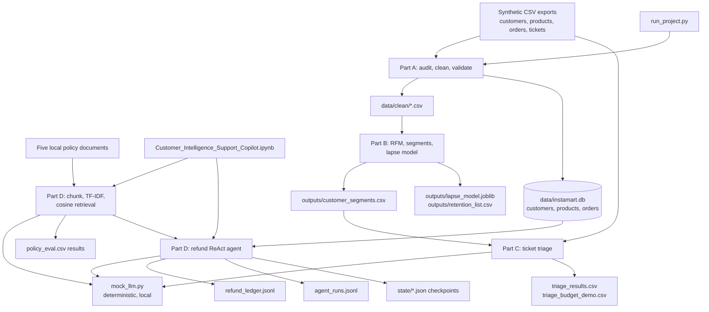

# Instamart Customer Intelligence & Support Copilot

An end-to-end, offline teaching project that turns synthetic quick-commerce data into customer segments and lapse-risk insights, privacy-aware ticket triage, grounded policy answers, and a database-backed refund-agent simulation.

[](https://www.python.org/)
[](https://pandas.pydata.org/)
[](https://scikit-learn.org/)
[](https://www.sqlite.org/)
[](#privacy-safety-and-guardrails)

> **Data and execution note:** All supplied customer, order, ticket, policy-evaluation, and scenario records are synthetic. Model and assistant calls use the local deterministic [`mock_llm.py`](./mock_llm.py); the project does not require an API key or make network calls.

## Table of contents

1. [Project overview](#project-overview)
2. [Business problem statement](#business-problem-statement)
3. [Project objectives](#project-objectives)
4. [System architecture](#system-architecture)
5. [Project modules](#project-modules)
6. [Technology stack](#technology-stack)
7. [Dataset description](#dataset-description)
8. [Machine learning methodology](#machine-learning-methodology)
9. [Results and evaluation](#results-and-evaluation)
10. [Privacy, safety, and guardrails](#privacy-safety-and-guardrails)
11. [Project folder structure](#project-folder-structure)
12. [Installation and setup](#installation-and-setup)
13. [How to run the project](#how-to-run-the-project)
14. [Output files](#output-files)
15. [Key learnings](#key-learnings)
16. [Future improvements](#future-improvements)
17. [Conclusion](#conclusion)

## Project overview

This project builds a fully local, end-to-end quick-commerce intelligence workflow using synthetic data. It covers data validation, customer segmentation, lapse-risk modeling, privacy-aware support ticket triage, grounded policy retrieval, and a simulated refund agent.

The system is designed for learning and portfolio demonstration rather than production deployment. It uses deterministic synthetic datasets, a local mock LLM, and SQLite-backed state tracking, with no external API calls or real payment execution.

## Business problem statement

The project addresses common operational issues in customer-facing commerce systems:

- **Data quality:** inconsistent categories, duplicate orders, malformed amounts, missing delivery times, and invalid customer values.
- **Retention risk:** identifying customers likely to lapse using only historical behavior available before the outcome window.
- **Customer segmentation:** grouping customers by behavior to support service prioritization and retention strategy.
- **Support workload:** routing and classifying large ticket volumes while protecting customer data and preserving review controls.
- **Policy accuracy and safety:** answering support questions using retrieved policy context and refusing unsupported or unsafe actions.
- **Auditability:** every refund decision, escalation, and checkpoint is traceable in local logs and state files.

## Project objectives

- Clean and validate synthetic customer, product, and order exports and save trusted tables to CSV and SQLite.
- Build RFM features, customer clusters, and dimensionality-reduction diagnostics to profile behavior.
- Train and evaluate churn/lapse models with time-aware feature and outcome windows.
- Apply PII redaction, prompt validation, token limits, retry logic, and human review rules for support automation.
- Ground policy answers in retrieved document chunks and simulate refund actions with tool checks and audit logs.
- Keep the workflow inspectable across Python modules, SQL, and a Jupyter notebook.

## System architecture



`run_project.py` runs Parts A, B, C, and policy retrieval evaluation. The notebook also includes the Part D refund-agent scenarios, safety-limit demonstrations, and crash/resume example; the standalone runner does not invoke that refund-agent demonstration.

## Project modules

### Part A — Data quality audit and cleaning

1. **Reproducible setup:** create the repository, set up a virtual environment, install dependencies, generate synthetic data, and configure `.gitignore`.
2. **Raw data audit:** inspect customers, products, and orders for missing values, duplicates, malformed data, and type issues.
3. **Customer cleaning:** normalize city names, gender values, invalid ages, and signup dates.
4. **Order cleaning:** remove duplicate orders, repair invalid order amounts, fill missing delivery durations, and discard pending orders.
5. **SQLite loading and validation:** save cleaned CSVs, build SQLite tables, and verify at least 8 validation checkpoints.
6. **SQL analysis:** write and execute queries using `GROUP BY`, `JOIN`, subqueries, `LEFT JOIN`, CTEs, and window functions.
7. **Pandas analysis:** conduct pivot tables, revenue analysis, descriptive statistics, outlier detection, correlation review, and exploratory questions.

[`src/data_pipeline.py`](./src/data_pipeline.py) validates raw exports, repairs common data issues, and writes trusted output tables to CSV and SQLite. Cleaning covers duplicate order IDs, malformed amounts, invalid delivery durations, inconsistent case values, and missing customer metadata.

### Part B — Customer intelligence and lapse prediction

- **RFM analysis:** calculate recency, frequency, and monetary value from completed orders.
- **K-means clustering:** standardize RFM features, evaluate `K=2..8`, and select the best customer segmentation.
- **Segment profiling:** profile behavioral clusters, label premium segments, and apply PCA for dimensionality diagnostics.
- **Lapse dataset construction:** define the lapse label and engineer behavioral, demographic, and order-based features without leakage.
- **Preprocessing:** apply one-hot encoding, scaling, and missing-value handling using training-data statistics only.
- **Model training and evaluation:** tune Logistic Regression and Random Forest using `GridSearchCV` and compare performance.
- **Class-balance experiment:** oversample the lapsed class in training folds and compare precision, recall, and F1.
- **Model interpretation and deployment:** inspect key features, reload the saved model, and generate the top-10 retention list.

[`src/customer_models.py`](./src/customer_models.py) builds the RFM data and the leakage-aware lapse model. It keeps feature engineering, preprocessing, and resampling inside the training pipeline to avoid test-set leakage and uses saved model artifacts to verify reproducible predictions.

### Part C — Support ticket triage with guardrails

1. **Input guardrails:** skip empty tickets and flag tickets above the 400-token limit.
2. **PII redaction:** remove email addresses, phone numbers, and order IDs before sending ticket text to the model.
3. **Prompt engineering:** use zero-shot and few-shot prompts with fixed categories and JSON-only response requirements.
4. **Retry handling:** recover from temporary model failures with up to three retries and exponential backoff with jitter.
5. **Output validation:** parse JSON responses, extract keywords, and route invalid outputs to human review.
6. **Prompt comparison:** compare accuracy, token usage, and confusion matrices for zero-shot and few-shot classification.
7. **Token budget and routing:** enforce budgets, route tickets by fraud and segment, and write final CSV outputs.

[`src/triage.py`](./src/triage.py) processes ticket text with redaction, input validation, prompt enforcement, retries, and routing. Invalid or unsupported outputs are not guessed; they are sent to human review, while fraud and premium cases receive priority routing.

### Part D — Policy retrieval and refund agent

- **Document chunking:** split five policy documents into 40-word chunks with 10-word overlap.
- **Vectorization and retrieval:** create TF-IDF vectors and retrieve the top three relevant chunks with cosine similarity.
- **RAG policy assistant:** answer questions using retrieved policy context and return explicit fallbacks when context is insufficient.
- **Retrieval evaluation:** evaluate 14 policy questions and compare overlapping vs. non-overlapping chunking.
- **Tool development:** implement `get_order`, `search_policy`, `calculate_refund`, `issue_refund`, and `escalate_to_human`.
- **ReAct agent:** build a tool-using refund workflow, run all 7 scenarios, and apply token, iteration, and timeout limits.
- **Safe execution and recovery:** use fallback responses, save checkpoints, and resume with `resume_agent` after a crash.
- **ReAct vs. plan-and-execute:** compare model calls, token usage, and error handling for workflow suitability.

[`src/policy_rag.py`](./src/policy_rag.py) and [`src/refund_agent.py`](./src/refund_agent.py) implement the retrieval and tool-using agent layers. The workflow is auditable: each tool decision, ledger entry, and checkpoint is stored locally without interacting with a production payment system.

## Technology stack

| Area | Technologies used |
|---|---|
| Programming language | Python (setup documented for Python 3.11) |
| Data processing | pandas, NumPy |
| Machine learning | scikit-learn, imbalanced-learn, joblib |
| Generative AI / LLM | Local `mock_llm.py` simulation; TF-IDF retrieval for policy passages |
| Storage | SQLite, CSV, JSONL |
| Visualization and inspection | Jupyter Notebook and pandas table displays; PCA variance is reported numerically |
| Development tools | VS Code, Jupyter, PowerShell |

No separate plotting library, hosted LLM SDK, or network API is used in the implemented workflow.

## Dataset description

The data generator in [`generate_data.py`](./generate_data.py) uses a deterministic random seed and writes fictional records. The row counts below were checked from the files currently in the project.

| Dataset | Rows | Important columns | Purpose |
|---|---:|---|---|
| `data/raw/customers.csv` | 1,200 | `customer_id`, `city`, `signup_date`, `age`, `gender` | Customer attributes; includes synthetic formatting and missing-value issues |
| `data/raw/products.csv` | 40 | `product_id`, `product_name`, `category`, `price_inr` | Product catalogue and price reference |
| `data/raw/orders.csv` | 13,084 | `order_id`, `customer_id`, `product_id`, `quantity`, `order_ts`, `status`, `discount_pct`, `order_amount`, `delivery_minutes` | Order history used for cleaning, RFM, lapse modelling, and SQLite lookups |
| `data/raw/tickets.csv` | 164 | `ticket_id`, `customer_id`, `order_id`, `text`, `true_category` | Synthetic support-ticket triage inputs and evaluation labels |
| `data/raw/policy_eval.csv` | 14 | `question`, `expected_doc`, `expected_fact` | Retrieval and grounded-answer evaluation questions |
| `data/raw/agent_scenarios.csv` | 7 | `scenario_id`, `user_message`, `expected_status`, `expected_refund_inr` | Refund-agent test scenarios |
| `data/policies/*.txt` | 5 documents | Policy prose | `refund_policy.txt`, `delivery_policy.txt`, `escalation_policy.txt`, `payment_policy.txt`, and `privacy_policy.txt` |

The tickets contain generated placeholder email addresses, phone numbers, and order IDs to exercise redaction. These are synthetic and are not reproduced here. The data is small, deterministic, and designed for teaching; it is not representative of live customer populations or suitable for production risk estimates.

The notebook also contains local data copies under `notebooks/data/` and `notebooks/data/raw_manual/` for its instructional exercises.

## Machine learning methodology

### Feature engineering and leakage prevention

- **RFM segmentation:** completed-order recency, unique-order frequency, and monetary total are calculated per customer. RFM uses the October 1, 2025 snapshot.
- **Lapse target:** customers without a completed order during September 2025 are labelled as lapsed. Model features use orders strictly before September 1, 2025.
- **Historical premium eligibility:** the retention eligibility calculation uses only pre-September RFM; later orders do not determine historical premium status.
- **Preprocessing:** numeric features use median imputation and standardization; categorical features use a constant `unknown` imputer and one-hot encoding. These transformations are fitted in the training pipeline.
- **Imbalance handling:** the `RandomOverSampler` is inside an `imblearn.pipeline.Pipeline`, so it is applied only to training data and within CV training folds. The test set is not oversampled.
- **Evaluation split:** stratified 80/20 customer split with `random_state=42`; five-fold grid search optimizes F1. The split is random across customers, while feature/label time windows are separated.

### Persisted model evaluation

Metrics below were recomputed in memory from the saved model artifact and the same feature and split logic in `src/customer_models.py`. The model artifact was not rewritten during this README update. Positive class `1` means “lapsed.”

| Model artifact | Best parameters | CV F1 | Test accuracy | Test precision | Test recall | Test F1 |
|---|---|---:|---:|---:|---:|---:|
| Random forest with `RandomOverSampler` | `max_depth=3`, `min_samples_leaf=5` | 0.7037 | 0.6983 | 0.5704 | 0.8652 | 0.6875 |

The cohort contains 1,156 customers: 713 non-lapsed and 443 lapsed. The stratified test set contains 232 customers (143 non-lapsed, 89 lapsed).

| Actual \ Predicted | Not lapsed (0) | Lapsed (1) |
|---|---:|---:|
| Not lapsed (0) | 85 | 58 |
| Lapsed (1) | 12 | 77 |

The high lapse recall comes with false positives, so accuracy alone is not sufficient for choosing a retention strategy. Feature importance is impurity-based and describes this fitted forest, not causal effects. Its leading features were frequency (0.3502), monetary value (0.2759), and recency (0.1422).

The saved segmentation has 1,175 customers with completed orders. Segment labels use monetary value and frequency profiles; they are descriptive clusters, not externally validated customer personas. PCA’s first two components explain 63.43% and 21.80% of variance (85.23% combined).

## Results and evaluation

### Part A — Data quality

The raw audit found the following issues. Blank-value counts are checked separately because the input CSVs are read with `keep_default_na=False`.

| Check | Observed |
|---|---:|
| Raw customer / product / order rows | 1,200 / 40 / 13,084 |
| Exact duplicate order rows | 119 |
| Pending order rows | 656 |
| Distinct raw order IDs | 12,309 |
| Unparseable order amounts | 120 |
| Negative delivery durations | 106 |
| Blank delivery durations | 2,541 |
| Blank customer ages / ages outside 10–100 | 61 / 6 |
| Distinct raw city / nonblank gender spellings | 24 / 10 |
| Blank gender values | 30 |
| Cleaned customers / products / orders | 1,200 / 40 / 12,309 |
| Cleaned order statuses | 11,110 completed; 1,199 cancelled |

The notebook’s Part A validation cell printed `ALL CHECKPOINTS PASSED`. The audit is a console report; there is no separate persisted audit report.

### Part B — Segmentation and lapse model

| Segment | Customers | Mean recency (days) | Mean frequency | Mean monetary value (INR) |
|---|---:|---:|---:|---:|
| At Risk | 618 | 52.48 | 3.31 | 948.18 |
| Frequent | 419 | 8.77 | 19.40 | 3,410.02 |
| Premium | 138 | 24.12 | 6.77 | 7,129.70 |

| Lapse-model measure | Value |
|---|---:|
| Held-out accuracy | 0.6983 |
| Held-out precision | 0.5704 |
| Held-out recall | 0.8652 |
| Held-out F1 | 0.6875 |
| Held-out confusion matrix | `[[85, 58], [12, 77]]` |
| Retention-list length | 10 |

### Part C — Ticket triage and token usage

The final few-shot CSV was joined to the synthetic ticket labels to calculate accuracy. The unbudgeted prompt comparison was also run in memory with output writing disabled.

| Prompt | Classified tickets | Accuracy | Total tokens | Tokens per classified ticket |
|---|---:|---:|---:|---:|
| Zero-shot | 147 | 85.7% (126/147) | 8,932 | 60.76 |
| Few-shot | 147 | 100% (147/147) | 16,576 | 112.76 |

Few-shot used 7,644 more tokens (about 52 additional tokens per classified ticket) and corrected 21 zero-shot category errors on this synthetic run.

| Final few-shot status | Tickets |
|---|---:|
| `classified_json` | 135 |
| `classified_keyword` | 12 |
| `flagged_invalid_output` | 9 |
| `skipped_empty` | 4 |
| `flagged_long` | 4 |

The 147 accepted classifications were all correct on these synthetic labels. The 17 invalid, empty, and long tickets were not assigned a guessed category and went to human review.

| Final route | Tickets |
|---|---:|
| `support_queue` | 102 |
| `security_team` | 34 |
| `premium_desk` | 11 |
| `human_review` | 17 |

PII redaction across a full run counted 55 email, 91 phone, and 132 order-ID substitutions (278 total); no matches from those three patterns remained in redacted text. The mock raised 19 transient errors per full run, and all were recovered.

The zero-shot budget demonstration used a 6,000-token budget and marked 51 tickets `budget_exhausted`. The output contains 6,023 total tokens because the budget is checked before a call; the call that crosses the threshold is counted, and subsequent eligible tickets are stopped.

### Part D — Retrieval and refund-agent evaluation

| Policy retrieval configuration | Expected document among top 3 | Expected fact in answer | Unanswerable fallback |
|---|---:|---:|---:|
| 40-word chunks, 10-word overlap | 12/12 | 12/12 | 2/2 |
| 40-word chunks, no overlap | 12/12 | 10/12 | 2/2 |

With zero overlap, the delivery-time and payment-failure facts are split at chunk boundaries, and the mock’s selected sentence omits the expected fact. For `refund policy late delivery`, all three top-ranked chunks come from `refund_policy.txt`.

| Scenario | Status | Refund (INR) | Model calls | Tokens |
|---|---|---:|---:|---:|
| S1 | `REFUND` | 128.25 | 5 | 887 |
| S2 | `REFUND` | 135.00 | 5 | 887 |
| S3 | `ESCALATE` | 1,999.00 | 5 | 894 |
| S4 | `DENIED` | 0.00 | 4 | 605 |
| S5 | `DENIED` | 0.00 | 3 | 346 |
| S6 | `NOT_FOUND` | 0.00 | 2 | 84 |
| S7 | `FALLBACK_MAX_ITERATIONS` | — | 6 | 3,096 |

The S1 token-limit demonstration returned `FALLBACK_TOKEN_LIMIT` at 348 consumed tokens; the call that exceeded the 200-token cap did not execute its requested tool. The zero-second demonstration returned `FALLBACK_TIMEOUT` before the first model call. S7 completed all six model calls within the default 6,000-token limit and then stopped at the iteration limit.

The crash/resume demonstration checkpointed after `get_order` and `search_policy`, then resumed with `calculate_refund` and `issue_refund`. Its final status was `REFUND` for INR 128.25 with no tool repeated.

ReAct used 5 model calls / 887 tokens for S1, 3 / 346 for S5, and 2 / 84 for S6. A plan-and-execute agent could reduce model calls by proposing a complete plan and replanning only on errors, but no plan-and-execute baseline was implemented or measured here. ReAct sees observations such as a missing or cancelled order before choosing the next action; it is the safer fit for this workflow because the tool-checked order state controls whether a refund may be issued or escalated.

## Privacy, safety, and guardrails

- **PII redaction:** applies the specified email, 10-digit phone, and order-ID patterns in order, and asserts those patterns are absent from prompt messages. Pattern redaction is defense in depth, not a guarantee that every sensitive detail or format is removed.
- **Input limits:** whitespace-only and over-400-estimated-token tickets do not call the classifier.
- **Retry handling:** transient mock errors are retried with bounded exponential backoff and jitter; failures are visible in retry logs.
- **Output validation:** only allowed JSON categories or exactly one allowed category word in a non-JSON response are accepted. Invalid outputs are sent to human review instead of guessed.
- **Token budget:** the triage pipeline stops making further calls after the running total reaches its configured budget. The refund agent separately stops when its model-call total exceeds its token limit.
- **Human-in-the-loop:** invalid outputs, empty/long tickets, token-exhausted tickets, and large refund requests are routed or escalated for human handling.
- **Fraud priority:** valid fraud classifications are routed to `security_team` with high priority before the ordinary premium-segment routing rule.
- **Refund controls:** refund tools re-check order existence, `completed` status, delivery duration, and amount before appending an issue/escalation action.
- **Offline boundary:** the local mock is deterministic and is not a hosted LLM. No actual payment is initiated by the ledger.

## Project folder structure

```text
instamart_customer_copilot_FOLDER/
├── data/
│   ├── raw/                  # Synthetic input CSVs and evaluation scenarios
│   ├── clean/                # Cleaned CSVs written by Part A
│   ├── policies/             # Five policy text documents
│   └── instamart.db          # SQLite tables written by Part A
├── notebooks/
│   ├── Customer_Intelligence_Support_Copilot.ipynb
│   └── data/                 # Notebook exercise copies, including raw_manual/
├── outputs/
│   ├── customer_segments.csv
│   ├── lapse_model.joblib
│   ├── retention_list.csv
│   ├── triage_results.csv
│   ├── triage_budget_demo.csv
│   ├── agent_runs.jsonl
│   └── refund_ledger.jsonl
├── sql/
│   └── queries.sql
├── src/
│   ├── __init__.py
│   ├── data_pipeline.py
│   ├── customer_models.py
│   ├── triage.py
│   ├── policy_rag.py
│   └── refund_agent.py
├── state/                    # JSON checkpoints for resumable agent runs
├── generate_data.py          # Deterministic synthetic-data generator
├── mock_llm.py               # Local offline mock
├── run_project.py            # Main Parts A–C and policy-RAG runner
├── GITHUB_RESOURCES.md       # Supplemental learning links
├── requirements.txt
├── .gitignore
└── README.md
```

There is no `pyproject.toml` or separate test directory in the inspected project. The notebook contains the instructional examples and assertions; `run_project.py` is the main command-line workflow.

## Installation and setup

Use Python 3.11 and run these commands from the project root in Windows PowerShell:

```powershell
py -3.11 -m venv .venv
.\.venv\Scripts\Activate.ps1
python -m pip install --upgrade pip
pip install -r requirements.txt
```

The requirements install pandas, NumPy, scikit-learn, imbalanced-learn, and joblib. In VS Code, open the project folder, use **Python: Select Interpreter**, and choose `.venv\Scripts\python.exe`. For notebooks, select the same environment as the notebook kernel.

The supplied synthetic input data is already present. To intentionally regenerate the raw CSVs and policy documents, run `python generate_data.py` from the project root; this rewrites those deterministic synthetic inputs.

## How to run the project

From the project root, with the virtual environment activated:

```powershell
python run_project.py
```

The runner executes these stages in order:

1. Audit raw customer, product, and order data.
2. Clean the data, write `data/clean/*.csv`, and load SQLite tables.
3. Validate cleaned data and database constraints.
4. Build RFM segments, evaluate lapse models, persist/reload the selected model, and write segmentation and retention outputs.
5. Run the few-shot ticket pipeline with a 100,000-token budget and write `outputs/triage_results.csv`.
6. Chunk policy text and print the policy evaluation results.

The runner expects the raw CSVs and policy files to exist; these are supplied in `data/raw/` and `data/policies/`. The notebook includes additional Part D refund-agent scenario and resume demonstrations.

## Output files

| File | Contents |
|---|---|
| `data/clean/customers.csv`, `orders.csv`, `products.csv` | Normalized and validated tables created by Part A |
| `data/instamart.db` | SQLite `customers`, `products`, and `orders` tables |
| `outputs/customer_segments.csv` | Customer RFM values, segment ID/name, and premium flag |
| `outputs/lapse_model.joblib` | Selected fitted preprocessing/model search object |
| `outputs/retention_list.csv` | Up to 10 high lapse-risk customers who meet historical premium eligibility; includes predicted probability and observed test label |
| `outputs/triage_results.csv` | Final few-shot ticket status, category, segment, route, priority, and token usage |
| `outputs/triage_budget_demo.csv` | Zero-shot budget demonstration results |
| `outputs/agent_runs.jsonl` | One JSON record per refund scenario, including calls, tokens, and tool steps |
| `outputs/refund_ledger.jsonl` | Append-only simulated refund issue/escalation actions with timestamp and amount |
| `state/*.json` | ReAct checkpoints with messages, token count, step number, and tools already executed |

JSONL ledgers append when demonstrations are run again, so they may contain repeated simulated actions from multiple runs. They are audit artifacts for this fictional exercise, not evidence of real refunds.

## Key learnings

- Data quality engineering: identify malformed, missing, duplicate, and inconsistent export values before modeling.
- Feature engineering: build customer-level RFM and behavior features from event records.
- ML evaluation: compare candidate models using stratified holdout evaluation and class-specific metrics.
- Leakage prevention: define the feature cutoff before the outcome window and calculate premium eligibility from historical data only.
- Imbalanced learning: place oversampling inside the training pipeline rather than resampling the test data.
- Prompt engineering: compare zero-shot and few-shot classification cost and performance.
- PII protection: redact specified identifiers before model prompts and validate the redacted prompt content.
- Resilience and cost control: retry transient failures and cap input or cumulative token use.
- Human-in-the-loop systems: route unsupported, invalid, high-risk, or constrained cases to review.
- Retrieval and agents: ground policy answers in retrieved passages and make tool actions auditable and resumable.

## Future improvements

The following are proposed, not implemented:

- Add a chronological customer-level holdout and backtesting across multiple lapse windows.
- Persist a versioned model evaluation report and compare all candidate models in a reproducible artifact.
- Expand privacy controls to detect additional sensitive formats and add prompt/data retention policies.
- Add unit and integration tests for data validation, routing precedence, refund authorization, and resume edge cases.
- Add semantic retrieval or hybrid search, with a larger policy corpus and human-reviewed groundedness evaluation.
- Add a production-grade database, authentication, authorization, idempotency keys, observability, and approval workflows before any real refund integration.
- Add CI checks for formatting, types, tests, and notebook execution.

## Conclusion

The project demonstrates how customer analytics and support automation can be combined while keeping data quality, time-aware modeling, privacy guardrails, human review, and auditability in view. Its measured results are useful for learning and evaluation on deterministic synthetic data; they should not be interpreted as production performance or authorization to automate real customer decisions.
